# Modelo lógico: Sistema de Gestão de Prestações Sociais

> Passo seguinte ao [DER conceptual](der-conceptual.md) e à [normalização](normalizacao.md).
> Aqui definem-se **colunas, chaves primárias (PK) e chaves estrangeiras (FK)**, tudo em 3FN e
> ainda sem depender de um motor concreto. O modelo físico (tipos Oracle, índices, DDL) vem no
> módulo 06. **Esta é a referência dos nomes de tabelas e colunas** usados nos exercícios.

## Regras para passar do conceptual ao lógico

| No conceptual | No lógico |
|---|---|
| Entidade | Uma tabela com uma **PK** |
| Relacionamento **1:N** | A **FK** vai para a tabela do lado **"muitos"** e aponta para a PK do lado "um" |
| Relacionamento **N:M** | Tabela associativa; a PK é **composta** pelas duas FKs |
| Atributo multivalorado | Tabela própria (1FN) |
| Catálogo (LOV) | Tabela pequena com PK e descrição |
| Histórico | Colunas `data_inicio_vigencia` e `data_fim_vigencia` (fim vazio = atual) |
| Chave natural (NISS, código) | **UNIQUE**, mais uma PK substituta (`id_...`) |

**Convenção de nomes:** a PK de cada tabela chama-se `id_<tabela>`, e a FK que aponta para ela
tem **o mesmo nome**. Assim o JOIN lê-se logo: `ped.id_pedido = pg.id_pedido`.

## Diagrama

```mermaid
erDiagram
    DISTRITO ||--o{ SERVICO_LOCAL : "tem"
    SERVICO_LOCAL ||--o{ TECNICO : "emprega"
    SERVICO_LOCAL ||--o{ MORADA : "serve"
    CIDADAO ||--o{ MORADA : "reside em"
    CIDADAO ||--o{ REL_DEPENDENTE : "é responsável em"
    CIDADAO ||--o{ REL_DEPENDENTE : "é dependente em"
    CIDADAO ||--o{ PEDIDO : "submete"
    TIPO_PRESTACAO ||--o{ PEDIDO : "é pedido em"
    ESCALAO ||--o{ PEDIDO : "enquadra"
    TIPO_PRESTACAO ||--o{ VALOR_ESCALAO : "tem valores em"
    ESCALAO ||--o{ VALOR_ESCALAO : "tem valores em"
    PEDIDO ||--o{ PEDIDO_DEPENDENTE : "inclui"
    CIDADAO ||--o{ PEDIDO_DEPENDENTE : "é incluído em"
    PEDIDO ||--o{ ATRIBUICAO : "tem"
    TECNICO ||--o{ ATRIBUICAO : "recebe"
    PEDIDO ||--o{ HISTORICO_ESTADO : "passa por"
    ESTADO ||--o{ HISTORICO_ESTADO : "é registado em"
    MOTIVO_INDEFERIMENTO |o--o{ HISTORICO_ESTADO : "justifica"
    PEDIDO ||--o{ DOCUMENTO : "tem anexado"
    TIPO_DOCUMENTO ||--o{ DOCUMENTO : "classifica"
    TIPO_PRESTACAO ||--o{ DOCUMENTO_OBRIGATORIO : "exige"
    TIPO_DOCUMENTO ||--o{ DOCUMENTO_OBRIGATORIO : "é exigido em"
    PEDIDO ||--o{ CONTA_BANCARIA : "indica"
    PEDIDO ||--o{ PAGAMENTO : "gera"
    CONTA_BANCARIA ||--o{ PAGAMENTO : "recebe"

    DISTRITO {
        number id_distrito PK
        varchar nome
    }
    SERVICO_LOCAL {
        number id_servico_local PK
        varchar codigo UK "ex.: SL-LRA"
        varchar nome
        number id_distrito FK
    }
    TECNICO {
        number id_tecnico PK
        varchar nome
        number id_servico_local FK
    }
    CIDADAO {
        number id_cidadao PK
        varchar niss UK
        varchar nome
        date data_nascimento
        varchar nif
        varchar email
        varchar telemovel
    }
    MORADA {
        number id_morada PK
        number id_cidadao FK
        number id_servico_local FK "servico responsavel por esta morada"
        varchar rua
        varchar codigo_postal
        varchar localidade
        date data_inicio_vigencia
        date data_fim_vigencia "vazio = morada atual"
    }
    REL_DEPENDENTE {
        number id_cidadao_responsavel PK, FK
        number id_cidadao_dependente PK, FK
        varchar tipo_relacao "filho, enteado, neto a cargo"
    }
    TIPO_PRESTACAO {
        number id_tipo_prestacao PK
        varchar codigo UK
        varchar nome
    }
    ESCALAO {
        number id_escalao PK
        varchar nome
        number rendimento_min
        number rendimento_max
    }
    VALOR_ESCALAO {
        number id_tipo_prestacao PK, FK
        number id_escalao PK, FK
        number ano PK
        number valor
    }
    ESTADO {
        number id_estado PK
        varchar nome
    }
    MOTIVO_INDEFERIMENTO {
        number id_motivo PK
        varchar descricao
    }
    PEDIDO {
        number id_pedido PK
        number id_cidadao FK
        number id_tipo_prestacao FK
        number id_escalao FK "vazio ate ser analisado"
        date data_submissao
    }
    PEDIDO_DEPENDENTE {
        number id_pedido PK, FK
        number id_cidadao_dependente PK, FK
    }
    ATRIBUICAO {
        number id_atribuicao PK
        number id_pedido FK
        number id_tecnico FK
        date data_inicio
        date data_fim "vazio = tecnico atual"
    }
    HISTORICO_ESTADO {
        number id_historico_estado PK
        number id_pedido FK
        number id_estado FK
        number id_motivo FK "so no indeferimento"
        varchar observacao
        date data_mudanca
    }
    TIPO_DOCUMENTO {
        number id_tipo_documento PK
        varchar nome
    }
    DOCUMENTO_OBRIGATORIO {
        number id_tipo_prestacao PK, FK
        number id_tipo_documento PK, FK
    }
    DOCUMENTO {
        number id_documento PK
        number id_pedido FK
        number id_tipo_documento FK
        date data_entrega
        varchar ficheiro "caminho do ficheiro"
    }
    CONTA_BANCARIA {
        number id_conta PK
        number id_pedido FK
        varchar iban
        date data_inicio_vigencia
        date data_fim_vigencia
    }
    PAGAMENTO {
        number id_pagamento PK
        number id_pedido FK
        number id_conta FK
        date mes_referencia
        number valor
        date data_pagamento
    }
```

## Decisões deste passo

| Decisão | Razão |
|---|---|
| **PK substituta** (`id_...`) em quase todas as tabelas, com a chave natural (`niss`, `codigo`) como **UNIQUE** | Estabilidade das FKs se uma chave de negócio tiver de ser corrigida |
| **MORADA.id_servico_local** | A entrevista diz que o pedido vai para o serviço local da área de residência. **A validar com o stakeholder**: se a área for definida por código postal, a ligação seria outra |
| **MOTIVO_INDEFERIMENTO** como catálogo, ligado ao **HISTORICO_ESTADO** | O motivo escolhe-se de uma lista, no momento do indeferimento. Fica opcional (`|o`) porque só existe nesse estado |
| **PEDIDO.id_escalao** pode estar vazio | O escalão só é atribuído quando o técnico analisa o pedido |
| **O estado atual não é uma coluna do PEDIDO** | Deduz-se do último registo em HISTORICO_ESTADO. Guardá-lo também no PEDIDO seria uma desnormalização controlada, a decidir por desempenho |
| **VALOR_ESCALAO**: PK composta (prestação, escalão, ano) | Os valores mudam todos os anos e variam por prestação |
| **REL_DEPENDENTE** vs **PEDIDO_DEPENDENTE** | A primeira diz *quem é filho de quem* (relação permanente); a segunda diz *que dependentes entram em cada pedido* |

## Regras de negócio que ficam por impor (modelo físico)

- Um cidadão não pode ter **dois pedidos ativos** do mesmo tipo de prestação.
- Só se paga um pedido em estado **Deferido**.
- Um técnico só analisa pedidos do **seu serviço local**.
- Só **um** dos responsáveis recebe o abono por cada dependente.

Estas regras implementam-se com restrições (`UNIQUE` parcial, `CHECK`), gatilhos (*triggers*) ou
no código da aplicação. A decisão, e onde se coloca cada uma, faz parte do modelo físico.
